# 旧物置换网站

> 🎓 **计算机毕业设计 · 旧物置换网站**
>
> 本仓库只放**项目介绍 + 运行截图**（截图是站点带水印的原图，存在仓库 `images/` 里）。
>
> 👉 **完整可运行源码 / 数据库脚本 / 部署文档：[点我获取](https://geekcode.top/archives/%E6%97%A7%E7%89%A9%E7%BD%AE%E6%8D%A2%E7%BD%91%E7%AB%99?utm_source=github)**
>
> 💬 咨询微信：**ir9372**　|　🌐 更多项目：[极客代码 geekcode.top](https://geekcode.top/?utm_source=github)
>
> 📌 项目详情页：<https://geekcode.top/archives/%E6%97%A7%E7%89%A9%E7%BD%AE%E6%8D%A2%E7%BD%91%E7%AB%99?utm_source=github>

<table><td width="230" align="center"> <b>扫码加微信 ir9372</b></td><td valign="middle">📦 源码 = 项目介绍 + 全部运行截图 + 数据库 + 部署文档 👉 点上方任意截图，直接跳到 <b>极客代码 geekcode.top</b> 详情页</td></table>

---

<h1>旧物置换网站</h1>
<h2>项目概述</h2>

本项目旨在构建一个基于 Web 的“旧物置换网站”，解决二手物品流通效率低、信息不对称及交易信任缺失等问题。系统采用前后端分离架构，核心功能涵盖旧物信息发布、分类浏览、在线评论互动、收藏管理以及置换交易记录等模块。适用人群包括希望闲置物品流转的个人用户（卖家/买家）及平台运营管理员。技术架构上，后端基于 Spring Boot 框架结合 MyBatis-Plus 进行数据持久化，使用 Shiro 实现安全认证与授权；前端采用 Vue 框架集成开发，提供流畅的用户交互体验。通过数字化手段优化旧物置换流程，提升资源利用率。

<h2>技术架构</h2>
<h3>1. 总体架构设计</h3>

系统采用典型的 B/S（Browser/Server）架构，遵循 MVC 设计模式。前端负责视图渲染与用户交互，后端提供 RESTful API 接口服务，数据库存储业务数据。

<a href="https://geekcode.top/archives/%E6%97%A7%E7%89%A9%E7%BD%AE%E6%8D%A2%E7%BD%91%E7%AB%99?utm_source=github" title="查看完整源码">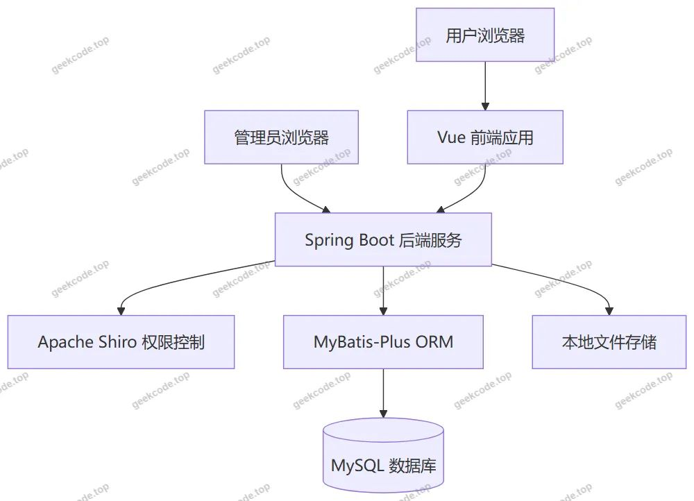</a>

<h3>2. 核心技术选型理由</h3>
<ul>
<li><strong>Spring Boot</strong>: 作为后端基础框架，利用其自动配置和起步依赖特性，简化了 Spring 应用的搭建过程，提供了稳定的 Web 服务能力。</li>
<li><strong>MyBatis-Plus</strong>: 在 MyBatis 基础上增强，提供了通用的 CRUD 操作和条件构造器，显著减少了样板代码，提升了开发效率。</li>
<li><strong>Apache Shiro</strong>: 用于处理身份验证、授权、会话管理和加密。相比其他安全框架，Shiro 更轻量且易于集成，适合本项目的权限管控需求。</li>
<li><strong>Vue (Integrated)</strong>: 前端采用 Vue 框架，通过组件化开发提高代码复用性，结合 Axios 等工具与后端进行异步数据交互，确保页面响应速度。</li>
<li><strong>MySQL</strong>: 关系型数据库，用于存储用户信息、旧物详情、交易记录等结构化数据，保证数据的一致性和完整性。</li>
</ul>
<h3>3. 数据库设计要点</h3>

根据 Controller 列表推断，数据库主要包含以下核心实体表：

<ul>
<li><strong>用户相关表</strong>: <code>yonghu</code> (普通用户), <code>maijia</code> (卖家), <code>admin</code> (管理员)。</li>
<li><strong>业务相关表</strong>: <code>jiuwuxinxi</code> (旧物信息主表), <code>jiuwuleixing</code> (旧物类型字典表), <code>zhihuanjiaoyi</code> (置换交易记录表)。</li>
<li><strong>互动与管理表</strong>: <code>news</code> (网站公告), <code>discussjiuwuxinxi</code> (旧物评论), <code>storeup</code> (收藏记录), <code>lunbotuguanli</code> (轮播图配置), <code>config</code> (系统配置)。</li>
<li><strong>文件表</strong>: 由 <code>FileController</code> 支持，存储上传的图片或附件路径。</li>
</ul>
<h2>功能模块</h2>
<h3>前台用户端</h3>

前台面向普通注册用户，提供旧物浏览、搜索、互动及个人管理服务。

<ol>
<li><strong>首页展示</strong></li>
</ol>
<ul>
<li>展示轮播图广告、最新旧物推荐、网站公告摘要。</li>
<li>提供全局搜索入口，快速定位感兴趣的商品。</li>
</ul>
<ol start="2">
<li><strong>旧物信息管理</strong></li>
</ol>
<ul>
<li><strong>列表浏览</strong>: 按类别、时间等维度分页展示旧物信息。</li>
<li><strong>详情查看</strong>: 显示旧物图片、描述、价格、卖家信息及剩余库存状态。</li>
<li><strong>评论互动</strong>: 用户对特定旧物发表文字评论，查看历史评论列表。</li>
</ul>
<ol start="3">
<li><strong>个人中心</strong></li>
</ol>
<ul>
<li><strong>账户维护</strong>: 修改头像、昵称、联系方式等基本资料。</li>
<li><strong>我的收藏</strong>: 查看已收藏的旧物列表，支持取消收藏。</li>
<li><strong>置换交易</strong>: 查看个人发起或参与的置换交易记录及状态。</li>
</ul>
<ol start="4">
<li><strong>资讯与服务</strong></li>
</ol>
<ul>
<li><strong>网站公告</strong>: 查看平台发布的官方通知和政策更新。</li>
<li><strong>卖家列表</strong>: 浏览平台注册的卖家信息及其信誉概况。</li>
</ul>
<h3>后台管理端</h3>

后台面向系统管理员，提供全平台数据的管理与维护功能。

<ol>
<li><strong>仪表盘首页</strong></li>
</ol>
<ul>
<li>展示关键数据统计概览（如用户数、商品数、交易量等）。</li>
</ul>
<ol start="2">
<li><strong>内容管理</strong></li>
</ol>
<ul>
<li><strong>公告管理 (<code>/news</code>)</strong>: 发布、编辑、删除网站公告，设置置顶或排序。</li>
<li><strong>轮播图管理 (<code>/lunbotuguanli</code>)</strong>: 配置首页轮播图的图片、链接及显示顺序。</li>
</ul>
<ol start="3">
<li><strong>业务数据管理</strong></li>
</ol>
<ul>
<li><strong>旧物信息 (<code>/jiuwuxinxi</code>)</strong>: 审核上架的旧物，管理商品信息，支持增删改查。</li>
<li><strong>旧物类型 (<code>/jiuwuleixing</code>)</strong>: 维护商品分类字典，添加新类别或删除废弃类别。</li>
<li><strong>置换交易 (<code>/zhihuanjiaoyi</code>)</strong>: 监控所有交易订单，处理异常交易，查询交易流水。</li>
<li><strong>评论管理 (<code>/discussjiuwuxinxi</code>)</strong>: 审核用户评论，删除违规或不雅言论。</li>
</ul>
<ol start="4">
<li><strong>用户与权限管理</strong></li>
</ol>
<ul>
<li><strong>卖家管理 (<code>/maijia</code>)</strong>: 注册卖家的资质审核、信息修改及封禁处理。</li>
<li><strong>用户管理 (<code>/yonghu</code>)</strong>: 普通用户的账号管理，重置密码或禁用账号。</li>
<li><strong>管理员考试 (<code>/adminexam</code>)</strong>: <em>注：根据路由存在此模块，推测为管理员技能考核或内部培训测试功能，具体逻辑依源码而定。</em></li>
</ul>
<h2>用户角色与权限</h2>

系统基于 Apache Shiro 实现细粒度的权限控制，主要划分为三类角色：

<table>
<thead>
<tr>
<th align="left">角色名称</th>
<th align="left">标识</th>
<th align="left">主要权限范围</th>
</tr>
</thead>
<tbody><tr>
<td align="left"><strong>超级管理员</strong></td>
<td align="left">admin</td>
<td align="left">拥有最高权限，可访问所有后台菜单，管理系统配置、用户账号、所有业务数据（旧物、交易、公告等），无限制地执行增删改查操作。</td>
</tr>
<tr>
<td align="left"><strong>卖家</strong></td>
<td align="left">maijia</td>
<td align="left">拥有发布和管理自己名下旧物信息的权限，可查看针对其商品的评论，参与置换交易，但无法访问后台管理界面或其他用户数据。</td>
</tr>
<tr>
<td align="left"><strong>普通用户</strong></td>
<td align="left">yonghu</td>
<td align="left">仅能访问前台页面，具备浏览、搜索、收藏、评论旧物以及查看个人中心和交易记录的权利。无法进行后台管理操作。</td>
</tr>
</tbody></table>

<strong>权限实现机制：</strong>

<ul>
<li>登录时生成 Token 或 Session ID。</li>
<li>拦截器校验请求来源的角色标识。</li>
<li>后台路由 <code>/admin/*</code> 仅限管理员访问，前台接口 <code>/front/*</code> 开放给登录用户或游客（视具体接口定义而定，如评论需登录）。</li>
</ul>
<h2>项目特色与创新点</h2>
<ol>
<li><strong>闭环的置换交易体系</strong>
   区别于传统的二手买卖平台，本项目强调“置换”概念，通过 <code>zhihuanjiaoyi</code> 模块专门记录以物换物的交易流程，体现了绿色循环经济的理念。</li>
<li><strong>多维度的社区互动</strong>
   集成了 <code>discussjiuwuxinxi</code> 评论系统和 <code>storeup</code> 收藏系统，不仅促进了买卖双方沟通，还通过收藏行为帮助用户建立个人兴趣库，增强了用户粘性。</li>
<li><strong>灵活的内容管理体系</strong>
   后台独立设计了 <code>lunbotuguanli</code> 和 <code>news</code> 模块，允许运营人员动态调整首页视觉焦点和重要通知，无需修改代码即可实时更新前端展示内容，提升了运营效率。</li>
<li><strong>标准化的分类字典管理</strong>
   通过 <code>jiuwuleixing</code> 表对旧物进行规范化分类，避免了自由文本输入带来的数据杂乱问题，便于前端筛选和后端统计分析。</li>
</ol>
<h2>部署环境</h2>

为确保系统正常运行，需准备以下软硬件环境：

<h3>1. 硬件要求</h3>
<ul>
<li>CPU: 双核及以上</li>
<li>内存: 4GB 及以上</li>
<li>硬盘: 至少 20GB 可用空间</li>
</ul>
<h3>2. 软件环境</h3>
<ul>
<li><strong>操作系统</strong>: Windows 10/11, Linux (CentOS 7+/Ubuntu 20.04+) 或 macOS</li>
<li><strong>JDK</strong>: Java Development Kit 1.8 或更高版本（推荐 JDK 8 或 11）</li>
<li><strong>数据库</strong>: MySQL 5.7 或 MySQL 8.0</li>
<li><strong>Web 服务器</strong>: 内置 Tomcat (Spring Boot 自带) 或外部 Nginx/Apache 用于反向代理</li>
<li><strong>Node.js</strong>: v14.x 或 v16.x (用于前端 Vue 项目的依赖安装与构建)</li>
<li><strong>包管理工具</strong>: Maven (后端依赖管理), npm/yarn (前端依赖管理)</li>
</ul>
<h3>3. 开发工具（可选）</h3>
<ul>
<li>IDE: IntelliJ IDEA 或 Eclipse</li>
<li>数据库客户端: Navicat 或 DBeaver</li>
<li>API 测试: Postman</li>
</ul>
<h2>五、技术特性</h2>
<ul>
<li>前后端集成部署，前端资源打包至后端 static 目录</li>
<li>使用 MyBatis-Plus 简化数据访问层开发</li>
<li>集成 Shiro 权限框架实现角色权限控制</li>
</ul>
<h2>六、功能模块截图</h2>
<h3>前台用户端</h3>
<h4>前台首页</h4>

<a href="https://geekcode.top/archives/%E6%97%A7%E7%89%A9%E7%BD%AE%E6%8D%A2%E7%BD%91%E7%AB%99?utm_source=github" title="查看完整源码">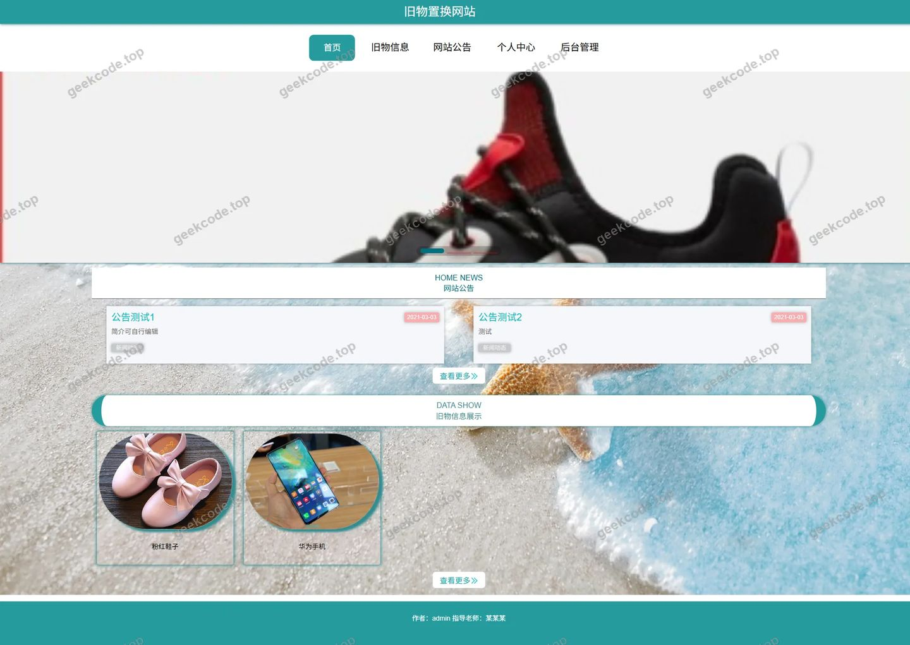</a>

<h4>前台登录页</h4>

<h4>前台注册页</h4>

<a href="https://geekcode.top/archives/%E6%97%A7%E7%89%A9%E7%BD%AE%E6%8D%A2%E7%BD%91%E7%AB%99?utm_source=github" title="查看完整源码">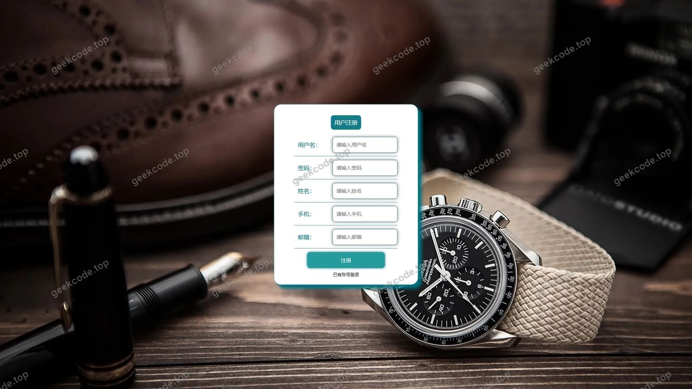</a>

<h4>前台-旧物信息列表</h4>

<a href="https://geekcode.top/archives/%E6%97%A7%E7%89%A9%E7%BD%AE%E6%8D%A2%E7%BD%91%E7%AB%99?utm_source=github" title="查看完整源码">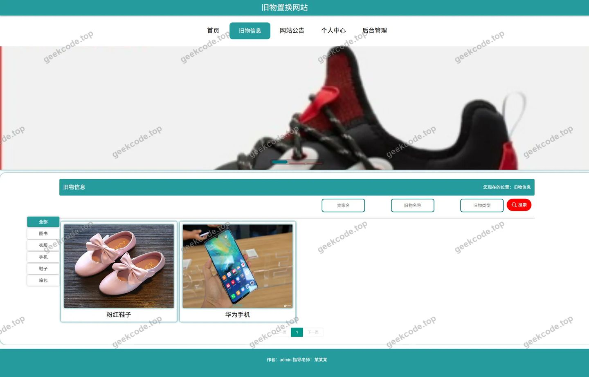</a>

<h4>前台-网站公告列表</h4>

<a href="https://geekcode.top/archives/%E6%97%A7%E7%89%A9%E7%BD%AE%E6%8D%A2%E7%BD%91%E7%AB%99?utm_source=github" title="查看完整源码">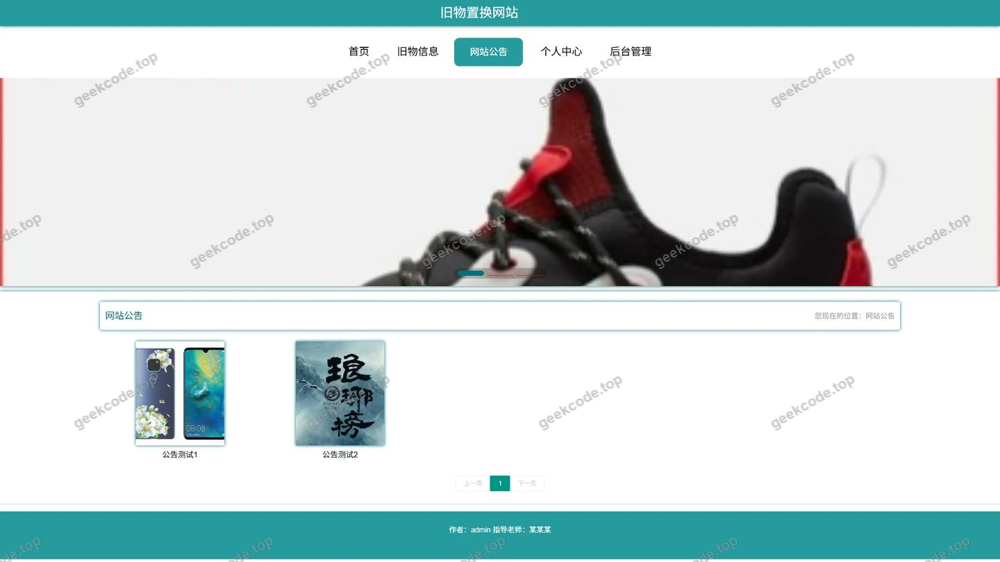</a>

<h4>前台-旧物信息评论列表</h4>

<a href="https://geekcode.top/archives/%E6%97%A7%E7%89%A9%E7%BD%AE%E6%8D%A2%E7%BD%91%E7%AB%99?utm_source=github" title="查看完整源码">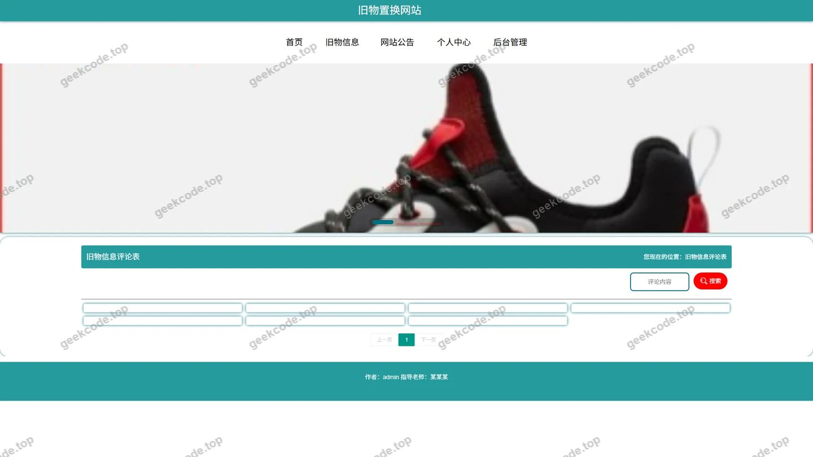</a>

<h4>前台个人中心</h4>

<a href="https://geekcode.top/archives/%E6%97%A7%E7%89%A9%E7%BD%AE%E6%8D%A2%E7%BD%91%E7%AB%99?utm_source=github" title="查看完整源码">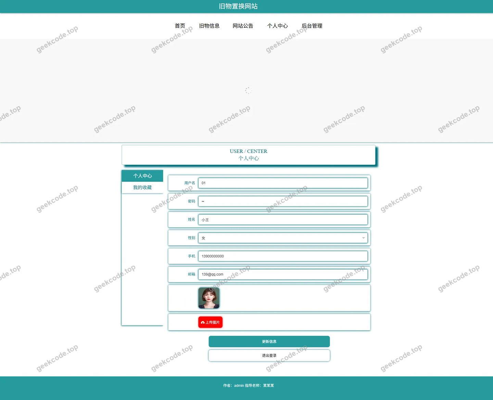</a>

<h4>前台-我的收藏列表</h4>

<a href="https://geekcode.top/archives/%E6%97%A7%E7%89%A9%E7%BD%AE%E6%8D%A2%E7%BD%91%E7%AB%99?utm_source=github" title="查看完整源码">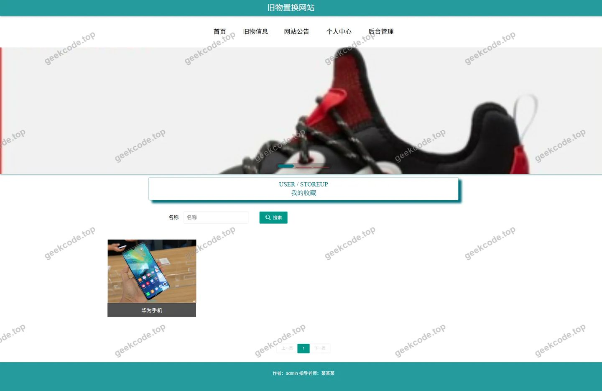</a>

<h4>前台-旧物信息-详情</h4>

<a href="https://geekcode.top/archives/%E6%97%A7%E7%89%A9%E7%BD%AE%E6%8D%A2%E7%BD%91%E7%AB%99?utm_source=github" title="查看完整源码">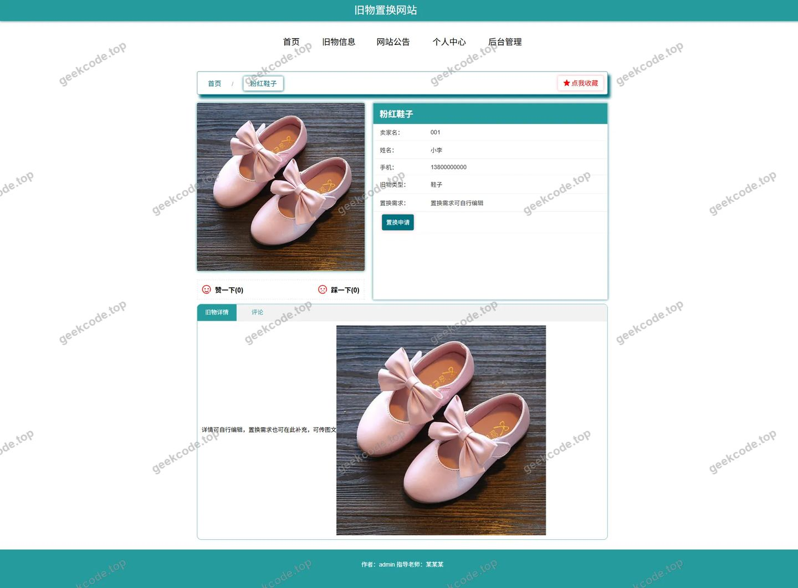</a>

<h4>前台-网站公告-详情</h4>

<a href="https://geekcode.top/archives/%E6%97%A7%E7%89%A9%E7%BD%AE%E6%8D%A2%E7%BD%91%E7%AB%99?utm_source=github" title="查看完整源码">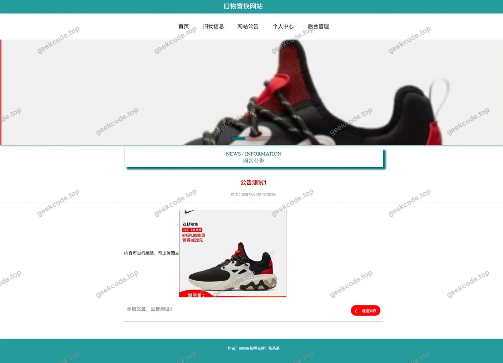</a>

<h4>前台-旧物类型列表</h4>

<a href="https://geekcode.top/archives/%E6%97%A7%E7%89%A9%E7%BD%AE%E6%8D%A2%E7%BD%91%E7%AB%99?utm_source=github" title="查看完整源码">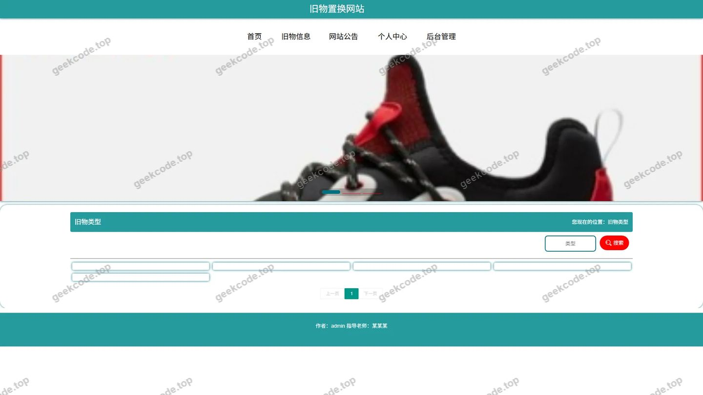</a>

<h4>前台-卖家列表</h4>

<h4>前台-置换交易列表</h4>

<a href="https://geekcode.top/archives/%E6%97%A7%E7%89%A9%E7%BD%AE%E6%8D%A2%E7%BD%91%E7%AB%99?utm_source=github" title="查看完整源码">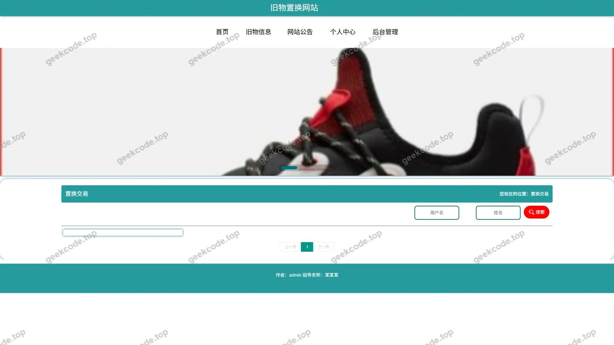</a>

<h4>前台-旧物信息评论-详情</h4>

<a href="https://geekcode.top/archives/%E6%97%A7%E7%89%A9%E7%BD%AE%E6%8D%A2%E7%BD%91%E7%AB%99?utm_source=github" title="查看完整源码">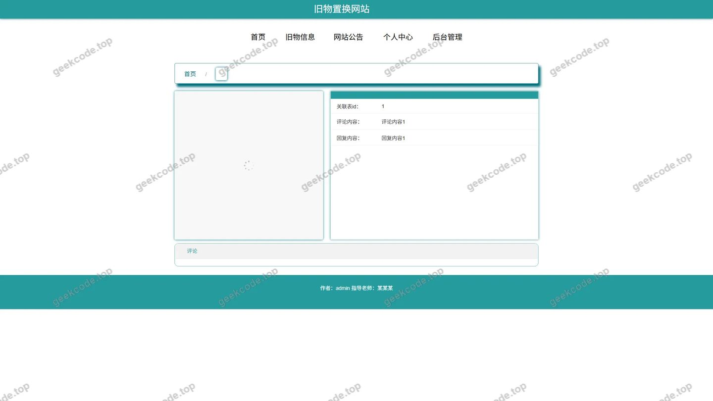</a>

<h3>后台管理端</h3>
<h4>后台-旧物信息评论</h4>

<a href="https://geekcode.top/archives/%E6%97%A7%E7%89%A9%E7%BD%AE%E6%8D%A2%E7%BD%91%E7%AB%99?utm_source=github" title="查看完整源码">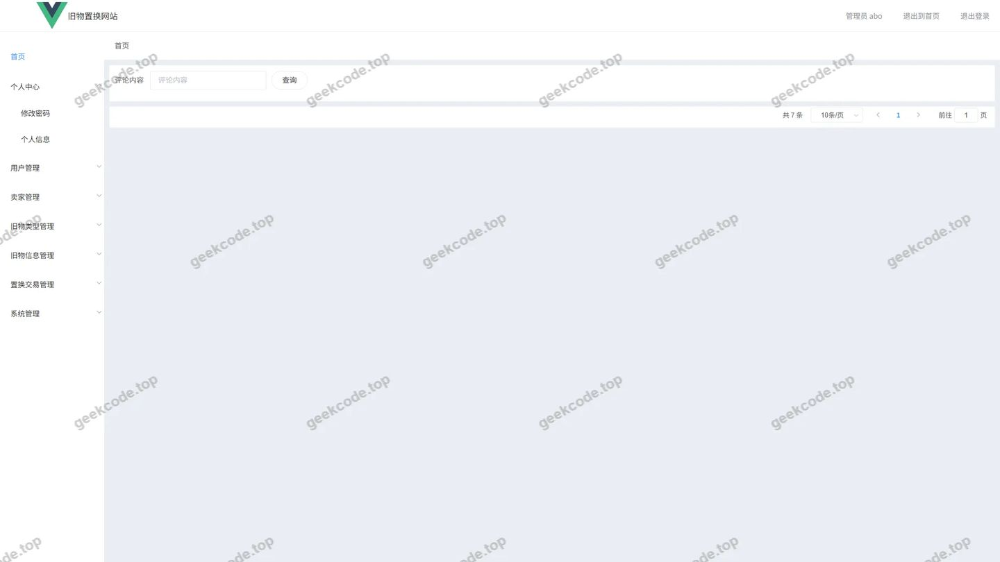</a>

<h4>后台首页</h4>

<a href="https://geekcode.top/archives/%E6%97%A7%E7%89%A9%E7%BD%AE%E6%8D%A2%E7%BD%91%E7%AB%99?utm_source=github" title="查看完整源码">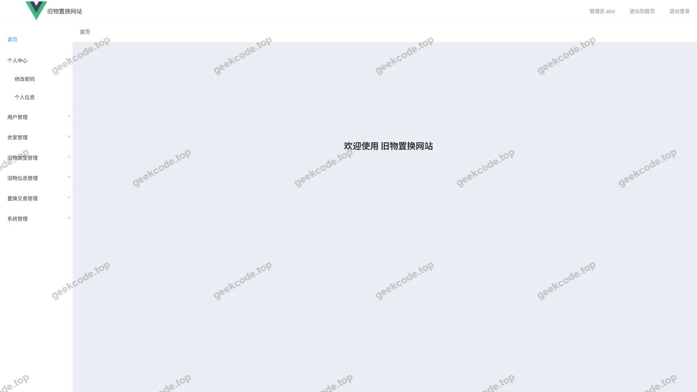</a>

<h4>后台-旧物类型</h4>

<a href="https://geekcode.top/archives/%E6%97%A7%E7%89%A9%E7%BD%AE%E6%8D%A2%E7%BD%91%E7%AB%99?utm_source=github" title="查看完整源码">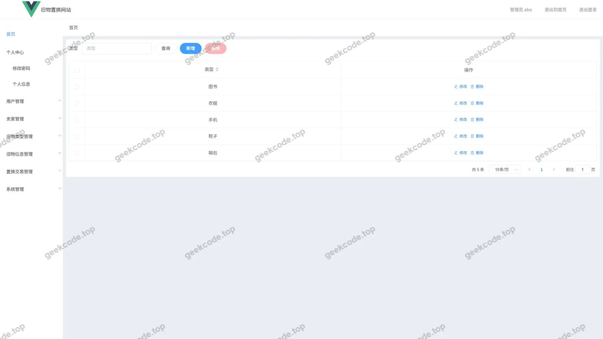</a>

<h4>后台-旧物信息</h4>

<a href="https://geekcode.top/archives/%E6%97%A7%E7%89%A9%E7%BD%AE%E6%8D%A2%E7%BD%91%E7%AB%99?utm_source=github" title="查看完整源码">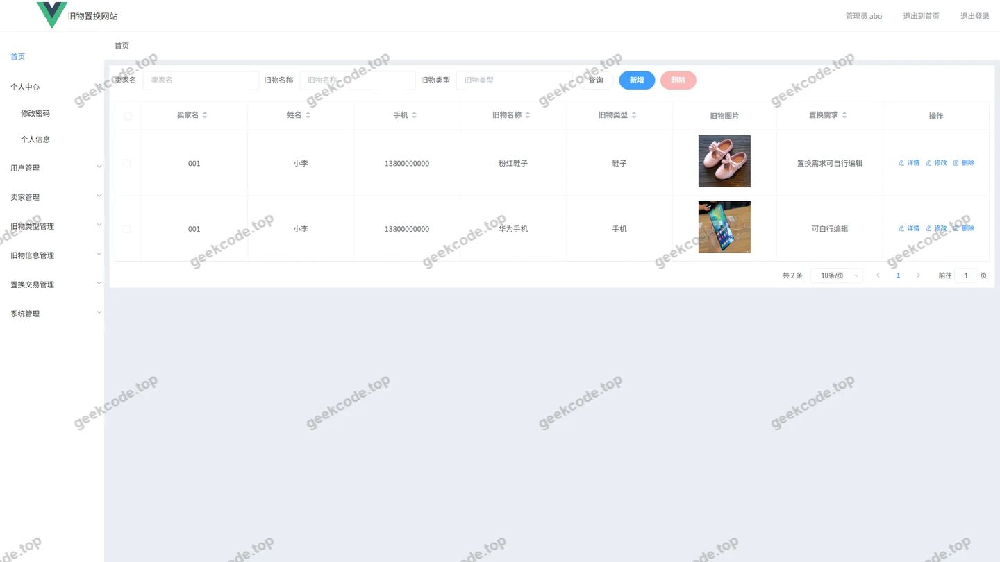</a>

<h4>后台-登录</h4>

<h4>后台-轮播图管理</h4>

<a href="https://geekcode.top/archives/%E6%97%A7%E7%89%A9%E7%BD%AE%E6%8D%A2%E7%BD%91%E7%AB%99?utm_source=github" title="查看完整源码">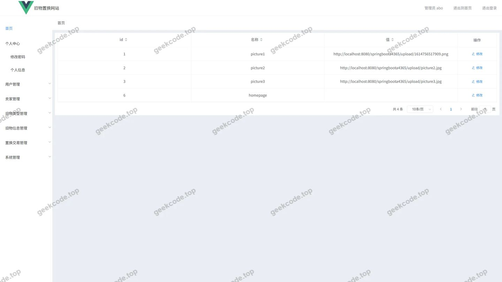</a>

<h4>后台-卖家</h4>

<a href="https://geekcode.top/archives/%E6%97%A7%E7%89%A9%E7%BD%AE%E6%8D%A2%E7%BD%91%E7%AB%99?utm_source=github" title="查看完整源码">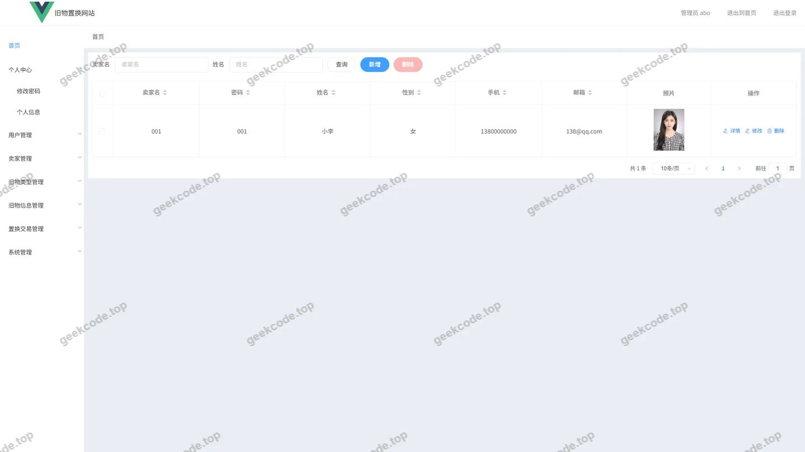</a>

<h4>后台-公告信息</h4>

<a href="https://geekcode.top/archives/%E6%97%A7%E7%89%A9%E7%BD%AE%E6%8D%A2%E7%BD%91%E7%AB%99?utm_source=github" title="查看完整源码">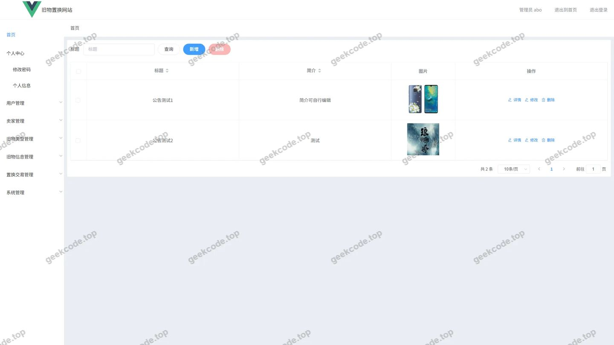</a>

<h4>后台-置换交易</h4>

<a href="https://geekcode.top/archives/%E6%97%A7%E7%89%A9%E7%BD%AE%E6%8D%A2%E7%BD%91%E7%AB%99?utm_source=github" title="查看完整源码">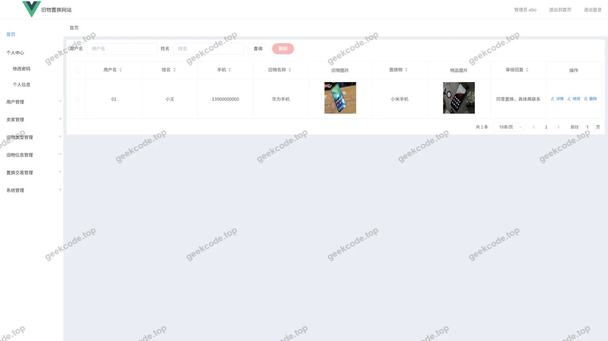</a>

---

## 获取完整源码

| 项目 | 说明 |
| --- | --- |
| 项目名 | 旧物置换网站 |
| 运行截图 | 本文 24 张（站点带水印原图，仓库 `images/` 目录） |
| 完整源码 | [https://geekcode.top/archives/%E6%97%A7%E7%89%A9%E7%BD%AE%E6%8D%A2%E7%BD%91%E7%AB%99?utm_source=github](https://geekcode.top/archives/%E6%97%A7%E7%89%A9%E7%BD%AE%E6%8D%A2%E7%BD%91%E7%AB%99?utm_source=github) |
| 咨询微信 | **ir9372**（备注：jingpin-yuanma） |
| 更多项目 | [极客代码 geekcode.top](https://geekcode.top/?utm_source=github) |

> 需要源码、部署、改配置、跑不起来等问题，加微信 ir9372 沟通，说明项目名即可。
